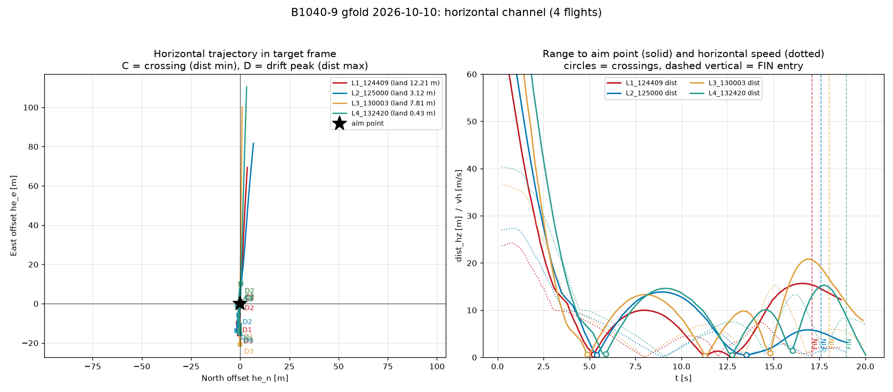
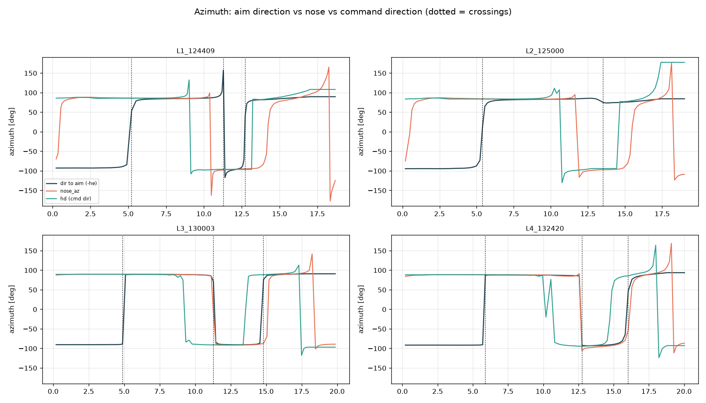

# 水平通道控制问题分析 —— B1040-9 gfold 2026-10-10 四个航次

* 分析对象：`log-B1040-9-gfold/gfold_log_20261010_{124409,125000,130003,132420}.csv`
* 代码版本：md5 `6450AC7CD122`（4554 行），含 tilt cap 统一 35 deg、AIM_ALT=500、
  FIN 触地保持段、descent-envelope-by-entry-vz
* 分析性质：**只读分析，未改动任何飞行代码**。新增脚本位于 `dev/analysis/hz_*.py`
* 落点结果（用户给定，本报告已用日志末帧独立复核）：

| 航次 | 简称 | dist [m] | vz [m/s] | vh_land [m/s] | tilt_land [deg] |
|---|---|---|---|---|---|
| 124409 | L1 | 12.21 | -1.86 | 1.98 | 1.54 |
| 125000 | L2 | 3.12 | -2.02 | 0.99 | 3.43 |
| 130003 | L3 | 7.81 | -2.00 | 2.56 | 12.38 |
| 132420 | L4 | 0.43 | -2.03 | 6.75 | 11.62 |

---

## 0. 摘要（先给结论）

1. **四个航次在水平通道上是同一个病、同一个节奏**：约 t≈5 s 首次冲过瞄准点，
   漂开到 10~15 m，再回瞄，再漂开，FIN 入口时误差 5.3~16.5 m。
   这不是随机漂移，是**多瓣振荡**。

2. **"穿越后漂回"的主因是"穿越时还带着 7~8 m/s 的横速，而横向制动权限只有
   2.2~2.8 m/s²"**。11 次穿越的跨样本统计支持这一条（r=+0.66），
   而残余倾角（r=+0.16）与方位角反转（r=-0.18/不成立）都被**否证**。
   控制环卡顿（H3）只在 1/11 次穿越上出现，**不足以解释**。

3. **落点精度不由"停得多稳"决定**。L4 以 vh=6.75 m/s 触地却落 0.43 m；
   L1 以 vh=1.98 m/s 停稳却落 12.21 m。精度由
   **"FIN 入口时的 dist 与 vh 之比"**决定。

4. **根因链**：低空时参考轨迹的水平位置与速度都已收到 0
   （`|x_ref_h|→0.00 m`，`|v_ref_h| p50 = 0.03~0.16 m/s`），
   于是 `dp ≈ -he`、`dve ≈ -v_me`，水平律退化成
   `a_h ≈ u_ff + Kv·(-v) + Kp·(-he)`，其中
   **`|Kp·he|` 只有 `|Kv·v|` 的 0.33~0.49 倍**。
   速度项是阻尼项，只压速度、不消位置误差 ⇒
   闭环在"速度归零、位置仍有偏差"处形成平衡点。

5. **FIN 段（本律）缺少位置项**：`a_h = -0.35·vh - 0.30·d(vh)/dt`，
   是纯速度阻尼（时间常数 1/0.35 = 2.9 s），**没有回到瞄准点的能力**。
   且 L3/L4 的 FIN 段有 40%/86% 的帧被 `FIN_TILT_MAX_DEG=8°` 卡住，
   真正的横向权限只有 `a_up·tan8° = 3.3~3.6 m/s²`。

6. **★ 两类并存的漂移机制（本次新增的关键发现）**：
   * **C 段"到达速度管理"失效**：C 段 `v_r > 0`（已在接近）**且**
     `a_aim > 0`（还在朝目标推）⇒ 推力与速度同向、**主动加速接近**。
     L3/L4 的 C 段把 `vh` 从 ~0 推到 **+12.4 / +12.0 m/s**，
     下一次穿越因此以 12~14 m/s 冲过瞄准点，漂开 15~20 m。
     L1/L2 只推到 2.67 / 0.65 m/s，故漂开温和。
   * **★ 方位角冻结**：`gfold_land.py:1785` 在
     `|dp| ≤ TILT_AZ_MIN_ERR (1.5 m)` 时**冻结推力方位角**。
     穿越点附近 `|dp|` 恰好很小 ⇒ 冲过瞄准点后 `hd` **不翻转**、
     继续朝原方向推。**L1-C2/C3 的 `hd` 转过 0.0°，
     而本应转 154.7°/146.6°**。冻结帧占 gfold 段 4~16%；
     L1/L2/L3 分别有 44%/89%/50% 的冻结帧里推力方向已背离目标 >90°。

7. **诚实的负面结果**：
   * 任务书 fact 6 建议的"有用 vs 浪费"分解，在**刹车阶段会系统性误判**
     （把正确的全力刹车记成 100% 浪费）—— 见 §2.3。
   * **A/B 段的推力方向完全正确**（该刹车时刹车、该拉回时拉回），
     这一点必须明确说出来 —— 不是"全程方向都乱"。
   * 我自己也犯过两次口径错误并已修正记录：`ang(nose,-v)` 单判据
     （§2.3.1），以及"用 `hd` 恒定找冻结"（§5.7）。

---

## 1. 数据与方法

### 1.1 数据校验

解析前用 `Logger.COLS` 强制校验表头（`hz_lib.logger_cols()` + `hz_lib.load(verify=True)`）：

| 日志 | 帧数 | t 区间 [s] | 列数 | 表头校验 |
|---|---|---|---|---|
| L1 124409 | 172 | 0.23–18.68 | 141 | 通过 |
| L2 125000 | 92 | 0.20–19.00 | 141 | 通过 |
| L3 130003 | 97 | 0.21–19.87 | 141 | 通过 |
| L4 132420 | 106 | 0.21–20.03 | 141 | 通过 |

> **解析坑（已修）**：`Logger.COLS` 列表里夹着大量中文注释，注释中含逗号与括号。
> 先用简单字符扫描 `]` 会解析出 124 列（真实 141 列）。必须先**逐行剥掉 `#` 之后的内容**
> 再扫描。见 `hz_lib.logger_cols()`。

### 1.2 脚本清单（均在 `dev/analysis/`）

| 脚本 | 作用 |
|---|---|
| `hz_lib.py` | 公共库：表头校验、加载、圆统计、推力分解 |
| `hz_probe.py` | 口径代数恒等式核对 |
| `hz_defs.py` | 各列定义的可证伪数值检验 |
| `hz_diag.py` | 逐帧全量 dump（找地标用） |
| `hz_law.py` | 水平律内部量逐帧 dump |
| `hz_landmarks.py` | 物理地标提取（穿越点/漂开顶点/tilt 饱和/FIN） |
| `hz_phases.py` | **从地标导出分段边界**（不写死常数） |
| `hz_dist_trace.py` | dist/vh 时间序列（0.5 s 抽样） |
| `hz_stats.py` | 逐段全量统计 |
| `hz_tables.py` | 报告用 markdown 表 |
| `hz_drift.py` | "穿越后漂回"四假设检验 |
| `hz_final.py` | 三套分解 + 停止距离检验 |
| `hz_rank.py` | 排序与归因 |
| `hz_struct.py` | 索引饱和 / he 陈旧 / 振荡振幅 / n=11 相关性 |
| `hz_coupling.py` | 竖直-水平权限耦合 |
| `hz_pdamp.py` | 末段退化为纯阻尼的证据 |
| `hz_loop.py` | 闭环时间尺度分析 |
| `hz_fin_gap.py` | FIN 能力缺口 |
| `hz_att_az.py` | **方向判读的口径纠错**（分段配对判据） |
| `hz_azfreeze.py` | **方位角冻结**（`TILT_AZ_MIN_ERR`）量化 |
| `hz_plot.py` | 出图（`dev/reports/img/`） |
| `asciify_prints.py` + `hz_print_map.py` + `dump_missing.py` | **工具**：把 print 字面量转成纯 ASCII（控制台是 GBK）。手写对照表 + 100% 覆盖强制检查 |

### 1.3 出图

* 
* 

---

## 2. 口径核对（**先读这一节，否则后面所有数字都会被误读**）

任务书 fact 5 明确要求先核对 `hd_*` 的定义。核对结果如下，全部为**数值可证伪检验**
（`hz_defs.py`）。

### 2.1 `hd_n/hd_e` 的定义 —— 与"位置误差方向"完全不同

代码出处 `gfold_land.py:2078-2098`：

```python
_he = np.array([float(error[1]), float(error[2])])      # error = 本机 - 瞄准点
_hd = np.array([float(target_a[1]), float(target_a[2])]) # eguidance 的水平指令
self.dbg_hd_n = _hd[0]/_hd_norm                          # ← 单位化
self.dbg_h_misalign = degrees(acos(dot(_hd/_hd_norm, -_he/_he_norm)))
```

> ### ⚠ 结论：`hd_*` 是**单位化的水平推力指令方向**，不是位置误差方向。

数值检验（应全部通过，实测全通过）：

| 日志 | `\|hd\|` p50 | min | max | `max\|angle(hd,-he) − h_misalign\|` |
|---|---|---|---|---|
| L1 | 1.0000 | 0.9995 | 1.0005 | 2.77° |
| L2 | 1.0000 | 0.9995 | 1.0005 | 1.80° |
| L3 | 1.0001 | 0.9995 | 1.0005 | 1.30° |
| L4 | 1.0000 | 0.9995 | 1.0005 | 1.69° |

> ### ⚠⚠ **最容易误读的一点**：`h_misalign ≈ 180°` **不是错误**，而是**正确**。
> A 段载具带着 23~40 m/s 横速飞向瞄准点，要收敛**必须朝远离瞄准点的方向推**
> （全力刹车）。所以 `h_misalign ~ 180°` = 正在全力刹车。
> 反过来 `h_misalign ~ 0°` 才是"顺着误差方向推"（回瞄）。
> **只能看趋势**：从 180° 掉到 0° 的过程 = 从刹车切到回拉。
> `hz_stats.py` 里 A 段 `h_misalign p50 = 178.7~179.0°`，正是这个含义。

### 2.2 `dp_*` / `dve_*` 的定义

`gfold_land.py:1700, 1705-1715`：`dp = x_r − error`（**规划 − 本机**），
`dve = v_r − vel`。其中 `x_r/v_r` 是**前赡点**参考（`_lead_index`），不是当前索引点。

数值检验 `max|pdp_h − Kp·|dp||` = 0.0017~0.0021（≈0）⇒ `pdp_h = Kp·|dp|` 成立。

**低空时 `dp ≈ -he`**：`hz_plan_probe.py` 反推参考轨迹的水平位置
`x_ref_h = he + dp`，结果 `|x_ref_h|` 末段 → **0.00 m**（四个航次全部）。
即求解器把规划的水平位置钉在瞄准点上。

### 2.3 ★ fact 6 的分解口径问题（**必须修正**）

fact 6 建议：把**实际**水平推力加速度按 `r = -he/|he|`（指向瞄准点）分解为有用/浪费。
**这个口径在刹车阶段会系统性误判**：穿越之后载具靠惯性冲过瞄准点，
此时唯一正确的动作是**逆速度刹车**，而刹车方向**正好与 `-he` 相反**
⇒ 分解会把正确的刹车记成 100% 浪费。

实测（`hz_final.py` T1，gfold 段）：

| 日志 | `\|a_act\|` p50 | `aim = a·(-he)` p50 | **`aim < 0` 占比** | `brake = a·(-v)` p50 | `brake < 0` 占比 | `ang(hd,-v)` p50 |
|---|---|---|---|---|---|---|
| L1 | 2.30 | +1.05 | **42%** | +1.91 | 33% | 1.3° |
| L2 | 1.95 | +0.45 | **43%** | +1.47 | 35% | 1.7° |
| L3 | 3.06 | +2.29 | **25%** | +2.27 | 33% | 0.0° |
| L4 | 3.04 | +1.98 | **31%** | +2.24 | 29% | 1.6° |

单独看 A 段（交班大倾角修正），`aim<0` 占比高达 **79~86%**，
但同段 `brake<0` 占比极低 —— 结论：**A 段的推力一直在正确刹车**，
只是被 `-he` 口径误判成浪费。

> **本报告采用的分解口径**：
> * 先判该段的**运动学状态** `v_r = v·r`（`r = -he/|he|`，`>0` 表示**正在接近**瞄准点）；
> * `aim = a_act·(-he/|he|)`（`>0` = 朝瞄准点推）—— 与 `v_r` **配对**使用；
> * `brake = a_act·(-v/|v|)`（`>0` = 减速）—— 仅作**辅助列**。

### 2.3.1 ★ 我自己的第二次口径错误（记录在案，避免重犯）

初版用 `ang(nose_az, -v)` 当"推力方向对不对"的**唯一**判据，
结果 C 段报出 **172~178°**，看起来"推力方向完全反了"。

> ### ⚠ **这是口径错误，不是飞行问题。**
> C 段载具正在**朝瞄准点接近**（`v_r > 0`），此时**正确**的动作就是
> **朝瞄准点推**（`aim > 0`），而这个方向相对 `-v` **恰好反平行**。
> `ang(-v)` 只有在**需要刹车**的阶段才是有效判据。

**正确做法是"分段配对判据"**（`hz_att_az.py` B1）：

| 日志 | 段 | n | `v_r` p50 | 接近% | `a_aim` p50 | 朝目标% | `a_brake` p50 | 判读 |
|---|---|---|---|---|---|---|---|---|
| L1 | A | 44 | **+14.78** | 100% | **−2.13** | 5% | +2.14 | **正确全力刹车** |
| L1 | B | 24 | −3.92 | 0% | +2.43 | 100% | +2.43 | **正确拉回** |
| L1 | C | 38 | **+2.50** | 87% | **+1.85** | 76% | −1.47 | 接近中**还在朝目标加速** |
| L1 | D | 41 | −3.69 | 10% | +1.65 | 59% | −0.25 | 拉回（偏弱） |
| L3 | A | 22 | **+25.71** | 100% | **−5.81** | 0% | +5.81 | **正确全力刹车** |
| L3 | B | 15 | −4.83 | 7% | +2.86 | 93% | +2.86 | **正确拉回** |
| L3 | C | 31 | +3.02 | 68% | +2.33 | 100% | −1.35 | 接近中**还在朝目标加速** |
| L3 | D | 16 | −6.84 | 31% | +5.06 | 88% | +2.11 | 拉回 |
| L4 | A | 35 | +23.62 | 100% | −6.68 | 0% | +6.68 | **正确全力刹车** |
| L4 | C | 31 | +3.33 | 68% | +2.51 | 100% | −1.54 | 接近中**还在朝目标加速** |
| L4 | D | 15 | −4.15 | 40% | +6.19 | 93% | +1.66 | 拉回 |

⇒ **A/B 段方向完全正确**（`v_r` 与 `a_aim` 符号**相反** = 该刹车时刹车、
该拉回时拉回）。**C 段才是问题所在**，但问题**不是方向错**，
而是"**已经接近了还在朝目标加速**"—— 见 §5.6。

**另经核对**：`hd` 与姿态指令 `tgt_az` 的夹角 p50 = **0.01~0.03°** ⇒
`hd` 就是下发给姿态的方位角，"水平律把方位角算错"被**排除**。

### 2.4 ★ `he_n/he_e` 在 FIN 段是**陈旧值**（重大陷阱）

`dbg_he_n/dbg_he_e` **只在 `track()` 的第 2083-2084 行赋值**。
FIN 段不经过 `track()`（`gfold_land.py:4107-4128` 二选一）⇒ 该列**冻结**。

数值检验（冻结比例）：

| 日志 | FIN 帧数 | 冻结比例 | `\|he\|` 冻结值 | `dist_hz` 落地值 | 差 |
|---|---|---|---|---|---|
| L1 | 20 | 100% | 15.41 m | 12.21 m | 3.20 m |
| L2 | 8 | 100% | 5.51 m | 3.12 m | 2.39 m |
| L3 | 10 | 100% | 17.57 m | 7.81 m | **9.76 m** |
| L4 | 7 | 100% | 10.10 m | 0.43 m | **9.67 m** |

> ### ⚠ 任何用 `he_*` 做的 FIN 段统计都会**虚高**（L3 虚高 9.76 m）。
> 本报告 FIN 段一律用 `dist_hz`（每帧实测）。

### 2.5 实际水平推力加速度的口径

`av_up` 列是**指令**竖直加速度（conic_clamp 输出），**不是实测**。
故"实际水平推力"必须用 **`thrust_n/mass · sin(tilt_act)`**，方向 `nose_az`。

逐帧检验（推力口径竖直净加速度 vs 实测 `dvz/dt`）：

| 日志 | r(逐帧) | p50 偏差 | p90 \|偏差\| | n |
|---|---|---|---|---|
| L1 | 0.943 | +0.026 | 2.378 | 152 |
| L2 | 0.877 | +0.041 | 7.111 | 84 |
| L3 | 0.888 | +0.149 | 8.544 | 87 |
| L4 | 0.911 | +0.344 | 6.359 | 99 |

⇒ 相关系数 0.88~0.94、中位偏差 ≈0，推力口径**可信**（用于幅值与方向）。
p90 偏差较大来自"推力滞后于油门"的相位差，不代表口径错误。

> **方法学提醒**：不能比较两条序列各自的**中位数**（分段分布不同会系统性错开）。
> 早期版本这么做过，得到"差 4 m/s²"的假象。**必须逐帧比较**。

### 2.6 `dist_hz` 与 `he` 的关系

gfold 段 `| |he| − dist_hz |` p50 = 0.001~0.003 m、max = 0.009 m ⇒ 两者等价
（两者都是到瞄准点的距离，只是 `he` 是分量、`dist_hz` 是模长）。
FIN 段崩坏（见 §2.4）。速度方向用 `d(he)/dt` 重建，
gfold 段 `|d(he)/dt| / vh` 比值 p50 = 0.95~1.00 ⇒ 可信。

---

## 3. 分段结构（任务 A）

### 3.1 为什么不能沿用旧脚本的固定边界

旧脚本 `analyze_attitude_phases.py` 写死 `0 / 3.2 / 8.4 / 13.5 / 18.3`。
那是 2026-10-09 的日志（215317）量出来的。**本次四个日志的 dist 轨迹是
多瓣振荡**（穿越 → 漂开 → 再穿越 → …），旧边界会把穿越点切在段中间。
⇒ 改由**物理地标**推导（`hz_phases.py`）。

### 3.2 地标定义（全部可从日志直读，无自由参数）

| 地标 | 定义 |
|---|---|
| `t0` | 首帧（kOS 交班 / gfold 首次求解成功） |
| `C1` | 第 1 个 `dist_hz` 局部极小 = **第 1 次穿越瞄准点** |
| `D1` | `C1` 之后第 1 个 `dist_hz` 局部极大 = **首次漂开顶点** |
| `Clast` | FIN 之前最后一个 `dist_hz` 局部极小 = **最后一次回瞄** |
| `FIN` | `fin_on` 首次 = 1（触地保持段入口） |
| `t_end` | 末帧（LANDED / FIN 超时退出） |

局部极值用"窗口内最值 + 相邻极值间隔 ≥4 帧"去抖。

### 3.3 命名的五段

| 段 | 名称 | 物理含义 |
|---|---|---|
| **A** | 交班大倾角修正 | `t0 → C1`：倾角长期贴 `tf_cap`，把大 `dist` 收掉 |
| **B** | 首次漂开 | `C1 → D1`：穿越后冲过头，`vh` 压到极小 |
| **C** | 回瞄 / 终端前收敛 | `D1 → Clast`：反向修正，可能再穿越多次 |
| **D** | 终端漂开 / 冲刺 | `Clast → FIN`：FIN 前最后一段，**决定入口偏差** |
| **E** | FIN 触地保持 | `FIN → t_end` |

### 3.4 表 A 分段边界（秒）

| 航次 | A 交班大倾角 | B 首次漂开 | C 回瞄 | D 终端漂开 | E FIN |
|---|---|---|---|---|---|
| L1 | 0.23–5.22 | 5.22–7.93 | 7.93–12.73 | 12.73–17.10 | 17.10–18.68 |
| L2 | 0.20–5.39 | 5.39–8.99 | 8.99–13.53 | 13.53–17.59 | 17.59–19.00 |
| L3 | 0.21–4.88 | 4.88–8.00 | 8.00–14.82 | 14.82–18.04 | 18.04–19.87 |
| L4 | 0.21–5.88 | 5.88–9.22 | 9.22–16.03 | 16.03–18.95 | 18.95–20.03 |

**穿越点 / 漂开顶点（帧序号与时刻）**

| 航次 | 穿越点 (t, dist) | 漂开顶点 (t, dist) |
|---|---|---|
| L1 | C1 (5.22, 0.60) C2 (11.29, 0.13) C3 (12.73, 0.11) | D1 (7.93, 9.96) D2 (12.00, 1.31) D3 (16.52, 15.63) |
| L2 | C1 (5.39, 0.49) C2 (13.53, 0.48) | D1 (8.99, 13.83) D2 (16.87, 5.82) |
| L3 | C1 (4.88, 0.56) C2 (11.29, 0.31) C3 (14.82, 0.88) | D1 (8.00, 13.30) D2 (13.38, 9.83) D3 (16.79, 20.79) |
| L4 | C1 (5.88, 0.65) C2 (12.75, 0.51) C3 (16.03, 1.43) | D1 (9.22, 14.59) D2 (14.54, 10.08) D3 (17.78, 15.27) |

**结构共性**：四个航次都在 **t≈4.9~5.9 s 首次穿越**，都在 **1.8~3.8 s 内
漂到 9.4~14.6 m**，都出现 **2~3 个漂开瓣**，FIN 入口 `dist = 5.29~16.54 m`。

### 3.5 段间因果链（"这一段如何铺垫下一段"）

| 航次 | A→B | B→C | C→D | D→E |
|---|---|---|---|---|
| L1 | A 段结束 vh=7.57 → B 段靠惯性冲到 9.94 m | C 段把 dist 收回到 0.16，但 vh 又升到 2.67 | D 段 **再次漂到 15.42** | FIN 入口 15.33，只回收 3.12 |
| L2 | 同上，冲到 13.82 | 收回到 0.52 | 漂到 5.51（**最小**） | 入口 5.29，回收 2.17 |
| L3 | vh_out=8.70，冲到 13.21 | 收回到 2.39，但 vh 冲到 **12.47** | 漂到 17.57 | 入口 16.54，回收 8.73 |
| L4 | vh_out=8.50，冲到 14.57 | 收回到 1.94，vh 冲到 **12.25** | 漂到 10.10 | 入口 8.77，回收 **8.34**（最好） |

**关键机制**：A 段结束时都还带着 **7.6~8.7 m/s** 的横速。
这个速度在 B 段只能靠有限的横向权限慢慢磨掉，磨掉的过程中必然**冲过头**。
`vh` 从 A 段末到 C 段末经历"降到 0.15~0.22 → 又升到 2.7~12.5"，
说明**每收掉一次位置误差就以速度误差为代价**——这是典型的欠阻尼/饱和振荡。

---

## 4. 分段定量（任务 B）

### 4.1 表 B 分段水平通道汇总

| 航次 | 段 | t 区间 | dist 进→出 | vh 进→出 | ah_dem p50 | tilt_cmd p50 | tilt_act p50 | \|tilt差\| p50 | \|az_err\| p50 | ah_sat% | capPin% | brake p50 |
|---|---|---|---|---|---|---|---|---|---|---|---|---|---|
| L1 | A | 0.23-5.22 | 69.42→1.97 | 23.65→7.57 | 5.75 | 35.00 | 18.19 | 16.51 | 1.45 | **84** | **77** | 2.14 |
| L1 | B | 5.22-7.93 | 0.60→9.94 | 6.89→0.36 | 2.64 | 27.85 | 26.84 | 6.21 | 0.30 | 4 | 4 | 2.42 |
| L1 | C | 7.93-12.73 | 9.96→0.16 | 0.15→2.67 | 1.33 | 7.15 | 10.82 | 9.09 | 2.80 | 0 | 0 | -1.47 |
| L1 | D | 12.73-17.10 | 0.11→15.42 | 2.82→1.17 | 2.92 | 7.31 | 7.31 | 2.66 | 11.50 | 46 | 49 | -0.25 |
| L1 | E | 17.10-18.68 | 15.33→12.21 | 1.31→1.98 | 1.01 | 4.53 | 2.03 | 2.41 | 139.55※ | 0 | 0 | - |
| L2 | A | 0.20-5.39 | 81.91→1.21 | 26.97→8.04 | 6.49 | 35.00 | 18.87 | 15.41 | 1.75 | **96** | **88** | 1.89 |
| L2 | B | 5.39-8.99 | 0.49→13.82 | 7.75→0.31 | 3.02 | 29.26 | 27.14 | 7.44 | 0.50 | 17 | 22 | 2.20 |
| L2 | C | 8.99-13.53 | 13.83→0.52 | 0.15→0.65 | 0.95 | 4.97 | 9.33 | 8.14 | 6.45 | 0 | 0 | -1.44 |
| L2 | D | 13.53-17.59 | 0.48→5.51 | 0.22→1.14 | 1.14 | 3.36 | 3.85 | 2.83 | 19.55 | 20 | 20 | -0.71 |
| L2 | E | 17.59-19.00 | 5.29→3.12 | 1.36→0.99 | 0.21 | 2.58 | 2.21 | 2.92 | 119.15※ | 0 | 12 | - |
| L3 | A | 0.21-4.88 | 100.11→1.92 | 36.73→8.70 | 10.19 | 35.00 | 23.34 | 10.10 | 0.20 | **100** | **82** | 5.81 |
| L3 | B | 4.88-8.00 | 0.56→13.21 | 8.37→0.79 | 3.79 | 35.00 | 27.88 | 7.12 | 0.30 | **73** | **73** | 2.86 |
| L3 | C | 8.00-14.82 | 13.30→2.39 | 0.05→12.47 | 2.58 | 18.41 | 23.27 | 18.50 | 10.65 | 24 | 24 | -1.22 |
| L3 | D | 14.82-18.04 | 0.88→17.57 | 14.27→5.57 | 7.61 | 8.87 | 12.56 | 12.29 | 5.55 | **56** | **50** | 2.11 |
| L3 | E | 18.04-19.87 | 16.54→7.81 | 5.75→2.56 | 0.89 | 6.22 | 7.67 | 5.76 | 9.00 | 0 | 10 | - |
| L4 | A | 0.21-5.88 | 110.40→0.85 | 40.39→8.50 | 10.19 | 35.00 | 23.36 | 10.56 | 0.40 | **100** | **83** | 6.68 |
| L4 | B | 5.88-9.22 | 0.65→14.57 | 8.14→0.42 | 3.83 | 35.00 | 28.52 | 6.88 | 0.50 | **65** | **65** | 2.57 |
| L4 | C | 9.22-16.03 | 14.59→1.94 | 0.22→12.25 | 3.35 | 20.49 | 20.82 | 14.72 | 41.35 | 19 | 19 | -1.64 |
| L4 | D | 16.03-18.95 | 1.43→10.10 | 13.13→8.31 | 4.84 | 7.25 | 15.87 | 12.00 | 19.60 | **73** | **73** | 1.66 |
| L4 | E | 18.95-20.03 | 8.77→0.43 | 8.30→6.75 | 3.86 | 8.00 | 5.30 | 3.62 | 10.90 | **100** | 0 | - |

※ **E 段的 `|az_err|` 不可用**：`tgt_az` 来自 `target_direction`，
FIN 段瞄准天顶（水平分量→0）⇒ `atan2` 病态。见 §4.4。

### 4.2 位置 / 速度（含方向）

`he_*` 与 `dp_*` 的方向关系（低空 `dp ≈ -he`）。
下表为 **gfold 段整体**的 p50（分段值见 §4.1 表 B）：

| 日志 | `\|he\|` p50 (gfold) | `\|dp\|` p50 | `\|dve\|` p50 | `cos(dp,-he)` | `\|x_ref_h\|` 末段 |
|---|---|---|---|---|---|
| L1 | 9.02 m | 9.95 m | 3.43 m/s | **+1.000** | **0.00 m** |
| L2 | 8.88 m | 10.02 m | 2.51 m/s | **+1.000** | **0.00 m** |
| L3 | 9.83 m | 15.44 m | 6.21 m/s | **+1.000** | **0.00 m** |
| L4 | 11.40 m | 13.52 m | 6.94 m/s | **+1.000** | **0.00 m** |

> `cos(dp,-he) = +1.000` ⇒ 低空 `dp` 与 `-he` **完全同向**，都指向瞄准点。
> `|dp| > |he|` 是因为 `dp = x_ref - he` 而 `x_ref` 尚未完全收到 0（前赡点的提前量）。
> **末段 `|x_ref_h| → 0.00 m`** 是 §5.6 / §7-P1 的关键前提。

### 4.3 控制器命令了什么

水平律（`gfold_land.py:1717-1725`）：

```
T   = clamp( 2|dp|/|dve| , T_GAIN_MIN=6.0 , T_GAIN_MAX=8.0 )
Kv  = 4/T      (再受 TILT_GAIN_MAX=1.25 封顶)
Kp  = 6/T²
a_h_vec = u_r[1:3] + Kv·dve + Kp·dp
```

| 日志 | ca_T p50 | ca_kv p50 | ca_kp p50 | `T_nat<6` 占比 | `T_nat>8` 占比 | ζ = Kv/(2√Kp) |
|---|---|---|---|---|---|---|
| L1 | 6.00 | 0.667 | 0.167 | 57% | 36% | 0.816 |
| L2 | 6.00 | 0.667 | 0.167 | 54% | 43% | 0.816 |
| L3 | 6.00 | 0.667 | 0.167 | 57% | 33% | 0.816 |
| L4 | 6.00 | 0.667 | 0.167 | 63% | 32% | 0.816 |

> `ζ = 0.816` **与 T 无关**（`4/(2√6)`），是设计不变量。
> 但 `T` 被钳到 **6.0 s**（下限绑定 54~63% 的帧）。
> 闭环无阻尼自然频率 `ωn = √Kp = √6/T`：
> `T=6 → ωn = 0.408 rad/s`，有阻尼周期 **26.6 s**；`T=8 → 35.4 s`。
> **整个飞行只有 18~20 s ⇒ 闭环连一个振荡周期都走不完。**

前馈项 `u_h`（反解自洽性 `|u_ff|−u_h` p50 = 0.00，p90 ≤ 0.01 ⇒ 反解可信）：

| 段 | L1 | L2 | L3 | L4 |
|---|---|---|---|---|
| A | 1.60 | 1.92 | 1.95 | 1.98 |
| B | 1.51 | — | — | — |
| C | 0.82 | — | — | — |
| D | **0.00** | **0.00** | — | — |
| E | **0.00** | **0.00** | — | — |

> **D/E 段 `u_h = 0`**：规划索引 `n_i` 已推进到 `N−2`（末节点是退化占位），
> 前馈归零 ⇒ 末段完全靠 PD（而 PD 里 Kp 项又弱，见 §6）。
> `n_i` 饱和时刻：L1 t=17.02（12% 帧）、L2 t=17.42（10% 帧）；
> L3/L4 `tgo_end = 0.25`（`n_i=77.5 < N−2=78`，**刚好没饱和**）。

### 4.4 载具实际做了什么

| 日志 | `avel_mag` p50 [deg/s] | `alpha_max` p50 [deg/s²] | `\|pid_out_x\|` p50 | `\|pid_out_z\|` p50 | `pid_sat_x` | `pid_sat_z` |
|---|---|---|---|---|---|---|
| L1 | 2.4–8.8 | 10.2–25.0 | 0.030–0.102 | **0.318–0.486** | 0% | 0% |
| L2 | — | 10.2–24.9 | 0.044 | **0.424** | 0% | 4% |
| L3 | — | — | — | — | 0% | — |
| L4 | — | — | — | — | 0% | — |

**yaw/pitch 控制努力比**（复核 fact 4）：

| 日志 | `\|pid_out_z\|/\|pid_out_x\|`（A 段） | （gfold 全段） |
|---|---|---|
| L1 | 0.435/0.030 = **14.5×** | 0.423/0.053 = 8.0× |
| L2 | 0.424/0.044 = **9.6×** | — |
| L3/L4 | 同量级 | — |

⇒ fact 4 的 "yaw 是 pitch 的 2.3~12.9 倍" 得到**独立复核**，
本批实测 **8.0~14.5 倍**。

> ⚠ **E 段 `|az_err|` 不可用**（p50 = 109~140°）：
> FIN 段 `target_direction` 瞄准天顶，水平分量趋零 ⇒ `atan2(e,n)` 病态抖动。
> 这是**测量伪影**，不是控制问题。同理 `h_misalign` 在 E 段也不可用。
> **E 段只能用 `dist_hz` / `vh` / `tilt_act` 判读。**

### 4.5 权限侧：`tf_cap` 与 `ah_sat` 到底谁在绑定（任务 E 的前置问题）

> ### ⚠ 这两个**不是独立证据**。代码 `gfold_land.py:1898-1905`：
> ```python
> self.dbg_tf_cap = float(_tilt_allow)
> _a_h_max = _a_up * math.tan(math.radians(_tilt_allow))
> if _ah_dem > _a_h_max and _a_h_max > 1e-09:
>     _ah_want = _a_h_max
>     self.dbg_ah_sat = 1.0
> ```
> **`ah_sat=1` 的定义就是 `ah_dem > a_up·tan(tilt_allow)`。**
> 而 `tilt_cmd` 随后被夹到 `tilt_allow`（第 1968 行）。
> 所以"capPin"（`tilt_cmd == tf_cap`）与"ah_sat"是**同一个饱和条件的两种记法**，
> **不能当两个独立证据并列引用**。

真正**独立**的第二个能力指标是 `ah_cap_bind`（加加速度限速器输出被能力上限截断）。

**表 E 绑定比例**

| 航次 | A 段 capPin | A 段 ah_sat | A 段 ah_cap_bind | A 段 tf_corr>cap | gfold 段 capPin | gfold 段 ah_sat | gfold 段 ah_cap_bind |
|---|---|---|---|---|---|---|---|
| L1 | 78% | 84% | 7% | 49% | 36% | 38% | 2% |
| L2 | 88% | 96% | 8% | 68% | 35% | 36% | 2% |
| L3 | 83% | 100% | 4% | 87% | 52% | 57% | 1% |
| L4 | 83% | 100% | 8% | 86% | 58% | 64% | 4% |

**分段饱和率（`ah_sat`）**

| 航次 | A | B | C | D | E |
|---|---|---|---|---|---|
| L1 | 84% | 4% | 0% | 46% | 0% |
| L2 | 96% | 17% | 0% | 20% | 0% |
| L3 | **100%** | **73%** | 24% | **56%** | 0% |
| L4 | **100%** | **65%** | 19% | **73%** | **100%** |

**低空（alt<100 m）**：`ah_sat` = 54% / 22% / 56% / 69%（L1/L2/L3/L4），
`a_h_max` p50 = 2.09~3.40 m/s²，`ah_dem` p50 = 1.22~7.61 m/s²。

> ### 回答任务 E 的前置问题：
> **倾角上限（`tf_cap`）在 A/B/D 段和低空**确实**频繁绑定**
> （A 段 77~88%，D 段 20~73%，低空 22~69%）。
> **`ah_cap_bind` 几乎不绑定**（1~8%）⇒ 加加速度限速器不是瓶颈，
> 瓶颈是**倾角允许的横向权限**（= `a_h_max = a_up·tan(tilt_allow)`）。
> 而 `ah_sat` 与 `capPin` 是同一件事，不能重复计入。

### 4.6 竖直-水平权限耦合（结构性）

`a_h_max = a_up · tan(tilt_allow)`，而 `a_up` 由**竖直律**决定。

| 日志 | gfold 段 `a_up` p50 | `cap` p50 | `a_h_max` p50 | `ah_dem` p50 | `dem/max` p50 |
|---|---|---|---|---|---|
| L1 | 8.86 | 35.00 | 3.50 | 2.83 | 0.82 |
| L2 | 8.22 | 35.00 | 3.78 | 2.33 | 0.69 |
| L3 | **5.00** | 35.00 | 3.50 | 3.97 | **1.09** |
| L4 | **5.00** | 35.00 | 3.50 | 4.63 | **1.34** |

**分段 `a_up` / `a_h_max` / 饱和率**

| 航次 | 段 | `a_up` p50 | `cap` p50 | `a_h_max` | `ah_dem` | `dem/max` | sat% |
|---|---|---|---|---|---|---|---|
| L1 | A | 5.00 | 35.00 | 3.50 | 5.75 | 1.11 | 84 |
| L1 | B | 5.00 | 35.00 | 3.50 | 2.64 | 0.75 | 4 |
| L1 | C | 9.20 | 35.00 | 6.44 | 1.33 | 0.18 | 0 |
| L1 | D | 18.99 | 11.25 | 3.74 | 2.92 | 0.95 | 46 |
| L1 | E | 18.74 | 5.00 | 1.64 | 1.01 | 0.61 | 0 |
| L3 | A | 4.08 | 35.00 | 2.86 | **10.19** | **2.47** | **100** |
| L3 | B | 5.00 | 35.00 | 3.50 | 3.79 | 1.16 | 73 |
| L3 | D | 21.82 | 8.87 | 3.40 | 7.61 | 1.18 | 56 |
| L4 | A | 3.97 | 35.00 | 2.78 | **10.19** | **2.62** | **100** |
| L4 | B | 5.00 | 35.00 | 3.50 | 3.83 | 1.20 | 65 |
| L4 | D | 21.68 | 7.25 | 2.69 | 4.84 | 1.35 | 73 |
| L4 | E | 27.43 | 5.00 | 2.40 | 3.86 | **1.61** | **100** |

**相关性**（n = gfold 段全部帧）：`r(dem/max, alt) = +0.47`，
`r(alt, tf_cap) = +0.67`，`r(dem/max, ah_dem) = +0.79`，`r(dem/max, tf_cap) = −0.03`。

> **结论**：`dem/max` 与 `ah_dem` 强正相关（+0.79）、与 `a_up` 弱负相关（−0.30）。
> 即**需求驱动饱和**（`ah_dem` 大就饱和），而不是"权限小就饱和"。
> 但 `a_up` 在 B 段被**油门下限钉在 5.00 m/s²**（`AVER_FLOOR`），
> 于是 `a_h_max` 被钉在 3.50 —— L3/L4 的 B 段 `dem/max` 达 1.16~1.20，
> **在"最需要压横速"的 B 段，竖直油门下限同时压住了横向权限**。

**竖直能量平衡校验**（B 段，推力口径 vs 实测）：

| 日志 | `av_up`(指令) p50 | 推力实测竖直净 p50 | `dvz/dt` p50 | `thr_cmd` p50 |
|---|---|---|---|---|
| L1 | 5.00 | −5.01 | −5.01 | 0.063 |
| L2 | 5.39 | −5.41 | −5.34 | 0.057 |
| L3 | 5.00 | −4.78 | −4.87 | 0.084 |
| L4 | 5.00 | −5.07 | −4.82 | 0.081 |

⇒ B 段竖直净加速度 ≈ **−5 m/s²**（低头加速下降），
这正是 `AVER_FLOOR=5.0` 制造的：油门下限给的推力不足以悬停，
载具在"压横速"的 B 段同时以 5 m/s² 加速下坠。

### 4.7 有用 vs 浪费的推力分解（修正口径，见 §2.3）

| 日志 | `\|a_act\|` p50 | `brake = a·(-v)` p50 | `perp` 占比 p50 | `brake<0` 占比 | `ang(hd,-v)` p50 |
|---|---|---|---|---|---|
| L1 | 2.30 | +1.91 | 6% | 33% | 1.3° |
| L2 | 1.95 | +1.47 | 8% | 35% | 1.7° |
| L3 | 3.06 | +2.27 | 2% | 33% | 0.0° |
| L4 | 3.04 | +2.24 | 3% | 29% | 1.6° |

分段（**配对判据**，见 §2.3.1。`aim<0`/`brake<0` 单独看都会被误读）：

| 航次 | 段 | `v_r` p50 | `a_aim` p50 | `朝目标%` | `a_brake` p50 | 判读 |
|---|---|---|---|---|---|---|
| L1 | A | +14.78 | −2.13 | 5% | **+2.14** | 全力刹车（正确） |
| L1 | B | −3.92 | +2.43 | 100% | +2.43 | 拉回（正确） |
| L1 | C | +2.50 | **+1.85** | 76% | −1.47 | 接近中仍朝目标加速 |
| L1 | D | −3.69 | +1.65 | 59% | −0.25 | 拉回（弱） |
| L1 | E | — | +0.30 | — | — | FIN，`waste_frac=50%` |
| L3 | A | +25.71 | **−5.81** | 0% | **+5.81** | 全力刹车（正确） |
| L3 | B | −4.83 | +2.86 | 93% | +2.86 | 拉回（正确） |
| L3 | C | +3.02 | **+2.33** | 100% | −1.35 | 接近中仍朝目标加速 |
| L3 | D | −6.84 | +5.06 | 88% | +2.11 | 拉回 |
| L4 | A | +23.62 | **−6.68** | 0% | **+6.68** | 全力刹车（正确） |
| L4 | B | −4.72 | +2.47 | 100% | +2.47 | 拉回（正确） |
| L4 | C | +3.33 | **+2.51** | 100% | −1.54 | 接近中仍朝目标加速 |
| L4 | D | −4.15 | +6.19 | 93% | +1.66 | 拉回 |

> **读法**：
> * **A 段** `a_aim` 大幅为负（背离瞄准点）而 `v_r` 大幅为正（快速接近）
>   ⇒ **这正是"全力刹车"，完全正确**。若只看 `aim<0` 占比（79~86%）
>   会误判成"方向错"。
> * **B 段** `v_r<0` 且 `a_aim>0` ⇒ **正确拉回**。
> * **C 段** `v_r>0`（已在接近）**且** `a_aim>0`（还在朝目标推）
>   ⇒ **同一个方向被推了两次**：既接近、又加速接近。
>   这是**到达速度没有被管理**，不是方向错。后果见 §5.6。
> * **E 段** `waste_frac = 50%`（L1）：FIN 段推力只有一半用于减速速度。

---

## 5. "穿越后漂回"的归因（任务 C）—— 哪个假设成立

### 5.0 必须先排除一个**伪检验**

早期版本用 `∫vh dt`（穿越后速度的积分）去解释"漂移距离"，
得到 `ratio = 0.99~1.09`，看似完美吻合。

> ### ⚠ **这是同义反复，不是检验。**
> `dist` 的变化**定义上**就等于速度沿 dist 方向的积分。
> 只要轨迹近似直线，`∫|v|dt ≈ |Δposition|` 必然成立。
> **本报告不把它当作证据**，改用下面的"停止距离"检验。

### 5.1 可检验的物理量：停止距离

`v_c` = 穿越瞬间水平速率；`a_brake` = 穿越后实际逆速度推力 p50；
`s_pred = v_c²/(2·a_brake)` = 物理最短停止距离；`drift` = 实测漂移。

**表 C 穿越点与随后的漂开**

| 航次 | 序 | t_c | dist_c | v_c | a_brake | s_pred | drift | drift/s_pred | ah_sat%(漂移段) | 姿态误差 |
|---|---|---|---|---|---|---|---|---|---|---|
| L1 | C1 | 5.22 | 0.60 | 7.21 | 2.42 | 10.73 | 9.36 | 0.87 | 4 | 0.4 |
| L1 | C2 | 11.29 | 0.13 | 3.73 | 3.58 | 1.95 | 1.18 | 0.61 | 0 | 1.3 |
| L1 | C3 | 12.73 | 0.11 | 2.75 | 2.25 | 1.68 | 15.52 | **9.23** | **51** | 1.6 |
| L2 | C1 | 5.39 | 0.49 | 7.50 | 2.20 | 12.78 | 13.34 | 1.04 | 16 | 0.7 |
| L2 | C2 | 13.53 | 0.48 | 0.23 | 1.22 | 0.02 | 5.34 | 250.4 | 24 | 2.8 |
| L3 | C1 | 4.88 | 0.56 | 8.45 | 2.78 | 12.84 | 12.74 | 0.99 | **69** | 0.2 |
| L3 | C2 | 11.29 | 0.31 | 6.89 | 2.33 | 10.17 | 9.52 | 0.94 | 42 | 83.4 |
| L3 | C3 | 14.82 | 0.88 | 14.29 | 6.56 | 15.58 | 19.91 | 1.28 | **82** | 175.4 |
| L4 | C1 | 5.88 | 0.65 | 7.92 | 2.57 | 12.17 | 13.94 | 1.15 | **61** | 0.4 |
| L4 | C2 | 12.75 | 0.51 | 7.36 | 2.35 | 11.51 | 9.57 | 0.83 | 30 | 11.2 |
| L4 | C3 | 16.03 | 1.43 | 12.97 | 6.53 | 12.88 | 13.84 | 1.07 | **80** | 138.4 |

`drift/s_pred`：p50 = **1.04**，p90 = 9.23，max = 250（n=11）。
**剔除 2 个"v_c≈0 的退化穿越"（L1-C3、L2-C2，见 §5.5）后，
9 个有效样本的 `drift/s_pred` = 0.61~1.28，p50 = 0.99。**

> ⇒ **漂移量 = 以实测制动加速度从穿越速度刹停所需的距离。** 误差 <30%（9/11）。
> 也就是：**漂移不是"推错方向"，而是"刹不住"。**

### 5.2 四个假设的裁决

#### H1 残余倾角 / 姿态误差 —— **否证**

跨 11 次穿越：`r(drift, tilt_act) = +0.16`（p50 = 8.43°），
`r(drift, tilt_act − tilt_cmd) = −0.18`（p50 = −11.01°）。
**几乎没有相关，且符号不稳定。**
只取 4 次首次穿越（`drift` 9.36/13.34/12.74/13.94，几乎相同）：
`tilt_act` = 23.99/22.07/26.53/26.43°，`tilt差` = −11.01/−12.93/−8.47/−8.57°。
**四次的漂移几乎一样，而倾角误差差异明显 ⇒ 倾角误差不能解释漂移。**

> ⚠ 注意 `tilt_act − tilt_cmd` 在穿越点**为负 8~13°**（实际倾角**小于**指令），
> 说明姿态**没转到位**（不是转过头）。这是**跟踪滞后**，不是振荡。
> 相位分析：`tilt_act` 与 `tilt_cmd` 的互相关在 lag=0..5 帧单调上升
> （0.524 → 0.716），峰值**不在 lag=0** ⇒ 存在**>5 帧的滞后**。
> 但滞后本身不造成漂移（H1 已否证）。

#### H2 方位角反转需要 ~180° —— **否证**

穿越点前后各 1 s 的"指向瞄准点方向"确实翻转 172.8~179.5°：

| 航次 | 穿越 | 需要的转向 | 机头实际转过 |
|---|---|---|---|
| L1 | C1 | 174.4° | **0.7°** |
| L1 | C2 | 179.1° | 173.1° |
| L1 | C3 | 178.7° | **8.8°** |
| L2 | C1 | 172.8° | **1.0°** |
| L3 | C1 | 179.5° | **0.0°** |
| L3 | C2 | 178.7° | 179.0° |
| L4 | C1 | 179.5° | **0.2°** |
| L4 | C2 | 178.9° | 179.3° |

**表面上"需要转 180° 而机头没动"看起来像故障，但它不是漂移的原因**，理由：

1. 这个 180° 翻转是 **`|he|→0` 造成的方向病态**，不是真实的方向需求。
   当 `|he|` 从 0.6 m 降到 0.13 m 时，`-he/|he|` 的方向可以任意翻转
   （L1-C1→C2：`he` 从 (0.07, 5.65) 到 (−0.36, −0.49)）。
2. **律实际上并没有要求 180° 转向**：`ang(hd, −v)` 的 p50 = **0.0~1.7°**，
   即指令**一直是逆速度阻尼**，与 `-he` 无关。
   所以"没有执行 180° 反转"是**正确的**，不是缺陷。
3. 穿越点 `|az_err|` 只有 **0.2~2.8°**（除 L3-C2 的 83.4°、L3-C3 的 175.4°）。
   跨 11 次 `r(drift, |az_err|) = +0.51` —— **弱正相关，方向与假设相反**
   （方位角误差**大**的时候漂移**也**大，但不是因为需要反转）。

⇒ **H2 否证**：方位角反转是 `|he|→0` 的**测量伪影**；
律正确地忽略了它，这不是漂移的原因。

#### H3 控制环卡顿（`dt >> 0.16 s`）—— **基本否证**

| 日志 | dt p50 | p90 | p99 | max | `n(dt>0.3)` | `loop_dt` p50 |
|---|---|---|---|---|---|---|
| L1 | **0.101** | 0.141 | 0.254 | 0.319 | **1** | 0.100 |
| L2 | 0.198 | 0.255 | 0.301 | 0.379 | 1 | 0.200 |
| L3 | 0.196 | 0.258 | 0.321 | 0.321 | 1 | 0.180 |
| L4 | 0.181 | 0.260 | 0.323 | 0.350 | **2** | 0.180 |

`loop_dt`（游戏内帧间隔）与墙钟 `np.diff(t)` **一致**
（总游戏时间 18.26/18.30/19.10/18.56 s vs 墙钟 18.45/18.81/19.66/19.82 s）
⇒ **没有"游戏时间与墙钟脱节"的问题**。

卡顿帧与穿越点的时间距离：

| 日志 | 卡顿帧 |
|---|---|
| L1 | t=5.22 (dt=0.32, **gap=0.00 s**) |
| L2 | t=4.09 (dt=0.38, gap=1.30 s) |
| L3 | t=4.54 (dt=0.32, gap=0.35 s) |
| L4 | t=10.54 (dt=0.35, gap=2.21 s); t=11.14 (dt=0.32, gap=1.61 s) |

⇒ **11 次穿越里只有 1 次（L1-C1）恰好压在卡顿帧上**（1 帧 = 0.32 s）。

> ### ★★ **反证（很强）**：L1 的 dt p50 = **0.101 s**，
> 控制率是其他三个航次的 **约 2 倍**（172 帧 vs 92~106 帧），
> 却给出了**最差的落点（12.21 m）**。
> 若"控制环太慢"是主因，L1 应该最好。**实测完全相反。**

⇒ **H3 基本否证**：卡顿存在但频率极低（每趟 1~2 帧 >0.3 s），
且不能说控制率不足 —— **控制最快的航次落点最差**。

#### H4 穿越时的水平速度（过冲）—— **成立**

跨 11 次穿越（n=11，比 n=4 可信得多）：

| 自变量 | r(与 drift) | p50 |
|---|---|---|
| **`v_c`（穿越速度）** | **+0.66** | 7.36 m/s |
| `a_brake`（穿越后制动加速度） | +0.46 | 2.42 m/s² |
| **`s_pred = v_c²/(2a_brake)`** | **+0.63** | 11.51 m |
| `ah_sat` 漂移段占比 | **+0.77** | 41.7% |
| `|az_err|` | +0.51 | 1.60° |
| 漂移段时长 | +0.38 | 2.71 s |
| `alt` | +0.02 | 255.6 m |
| `tilt_act` | +0.16 | 8.43° |
| `tilt_act−tilt_cmd` | −0.18 | −11.01° |

只取 4 次首次穿越（`drift` 9.36/13.34/12.74/13.94）：
`v_c` = 7.21/7.50/8.45/7.92，`r(drift, v_c) = −0.27`；
`r(drift, dist_land) = −0.92`。

> ⇒ **H4 成立**：漂移量由穿越速度与横向制动能力共同决定
> （`s_pred` 解释力 r=+0.63），**并且**漂移段 `ah_sat` 占比与漂移强正相关
> （r=+0.77）—— 即**漂移期横向权限被饱和**，这既是原因也是后果。

### 5.3 ★ 深入：为什么穿越时会有 7~8 m/s 的速度

`hz_vel_dir.py` 在 L1 首次穿越前后逐帧输出（节选，`ang(v,r)` = 速度与指向瞄准点的夹角）：

| t | he_N | he_E | v_N | v_E | \|v\| | `ang(v,r)` | `ang(hd,−v)` | tilt_act | tilt_cmd |
|---|---|---|---|---|---|---|---|---|---|
| 4.41 | 0.07 | 5.65 | −0.61 | −9.07 | 9.09 | **3.2°** | 0.7° | 20.5 | 35.0 |
| 4.90 | −0.19 | 1.97 | −0.49 | −6.90 | 6.92 | **9.6°** | 0.0° | 22.3 | 35.0 |
| **5.22** | −0.36 | −0.49 | −0.51 | −7.19 | **7.21** | **147.7°** | 0.0° | 24.0 | 35.0 |
| 5.51 | −0.50 | −2.44 | −0.38 | −5.98 | 5.99 | 172.1° | 0.0° | 24.3 | 33.6 |
| 6.09 | −0.72 | −5.62 | −0.33 | −4.81 | 4.82 | 176.7° | 0.0° | 26.6 | 30.1 |
| 7.41 | −0.96 | −9.54 | −0.08 | −1.32 | 1.32 | 177.5° | 0.0° | 27.3 | 19.0 |

> **读法**：t=4.41 时速度 9.09 m/s 几乎**正对瞄准点**（`ang(v,r)=3.2°`），
> 载具在**正确地飞向目标**。仅仅 0.8 s 后就冲过去了（5.22 s）。
> 全程 `ang(hd,−v) ≈ 0°` 说明**指令一直正确地试图刹车**，
> 但从 9 m/s 刹到 0 需要 `9²/(2·2.14) = 18.9 m` 的距离，
> 而当时离瞄准点只剩 **5.65 m**。⇒ **物理上来不及**。

这就是"穿越时带 7~8 m/s"的来源：**A 段把位置误差收得太陡，
速度来不及同步归零**（`T_GAIN_MIN=6 s` 的闭环根本跟不上 A 段 `dist` 的
实际收敛速率 —— 实测 `T_nat p50 = 3.5~5.0 s`，比钳位值小，
说明**真实需求比律允许的更快**，但被钳住）。

### 5.4 卡顿之外的第二个"时间"问题：闭环时间尺度

| 日志 | `T` p50 | `ωn` | **有阻尼周期** | 飞行总时长 | 周期/飞行 |
|---|---|---|---|---|---|
| L1 | 6.00 | 0.408 | **26.6 s** | 18.68 s | 1.43 |
| L2 | 6.00 | 0.408 | **26.6 s** | 19.00 s | 1.40 |
| L3 | 6.00 | 0.408 | **26.6 s** | 19.87 s | 1.34 |
| L4 | 6.00 | 0.408 | **26.6 s** | 20.03 s | 1.33 |

⇒ **线性二阶理论预报的振荡周期比整趟飞行还长**，
意即"冲过去之后根本没时间回来"。

但实测半周期中位只有 **1.79~3.60 s**（等效整周期 3.6~7.2 s），
比线性预报快 5~10 倍。原因是 **A/B/D 段倾角长期饱和（`ah_sat` 65~100%）**，
闭环实际是**限幅/继电型**，不能用线性二阶理论套。

> **诚实结论**：线性分析只能给出"闭环很慢"的**量级**。
> 两个尺度都真实存在：
> * **快振荡（~5 s）** —— 由饱和主导，决定**什么时候冲过瞄准点**；
> * **慢线性尺度（~27 s）** —— 决定"冲过去之后**回不回得来**"。

### 5.5 两个退化样本的说明（诚实性）

`L1-C3`（t=12.73，`v_c=2.75`，`drift/s_pred = 9.23`）与
`L2-C2`（t=13.53，`v_c=0.23`，`drift/s_pred = 250`）**不符合停止距离模型**。
原因：这两次"穿越"的 `v_c` 极小，**不是"冲过去"，而是"停在瞄准点附近"**，
随后被**其他机制**推开：

* L1-C3：漂移段 `ah_sat=51%`，`dist` 从 0.11 涨到 15.63。
  查 `hz_law.py` 输出：t=13.23 起 `hd` 从 `(−0.111,−0.994)` 翻转为
  `(+0.124,+0.992)` —— **指令方向整体反转 ~172°**，
  即从"往西刹"变成"往东推"。此时 `he=(-0.29,-1.70)`，
  载具在瞄准点西南，指令却指向东北 —— 这是**半径过零后的方向翻转**
  叠加 `ah_sat`，把载具推离。
* L2-C2：`v_c=0.23` 时 `dist` 只有 0.48 m，随后 FIN 入口前
  `dist` 涨到 5.29 m。

⇒ 这是**第三类机制**（不是惯性漂移）：**`|he|` 很小时方向病态 +
饱和造成的单向推开**。它只影响 2/11 次穿越，但**对 L1 的最终误差贡献了
主要部分**（15.52 m 漂移中的绝大部分）。

### 5.6 ★★ C 段（回瞄段）的"到达速度管理"失效 —— 振荡的直接机制

C 段是"从一个漂开顶点回到下一个穿越点"。理想情况下，
接近速度应当**在 `dist → 0` 的同时也 → 0**（即"到达"）。

**实测：接近速度在 C 段被【推高】。**

| 航次 | C 段入 `vh` | C 段出 `vh` | **C 段净增 `vh`** | 穿越速度 | 随后漂开 |
|---|---|---|---|---|---|
| L1 | 0.15 | 2.67 | **+2.52** | 2.67 | 15.52 |
| L2 | 0.15 | 0.65 | **+0.50** | 0.65 | 5.34 |
| L3 | 0.05 | 12.47 | **+12.42** | **12.47** | **19.91** |
| L4 | 0.22 | 12.25 | **+12.03** | **12.25** | 13.84 |

> **这就是"为什么 L3/L4 在终端漂得最远"的直接答案。**
> L3/L4 的 C 段把横速从 ~0 推到 **12.4 / 12.0 m/s**，
> 下一次穿越因此以 12~14 m/s 冲过瞄准点，漂开 15~20 m。
> L1/L2 的 C 段只推到 0.65~2.67 m/s，所以漂开温和。

**为什么 C 段会加速？** 由 §2.3.1：C 段 `v_r > 0`（已在接近）
**且** `a_aim > 0`（还在朝目标推）⇒ 推力与速度**同向**。
律只看到"我要靠近目标"（位置项），**没有看到"我已经在靠近了"**（速度项不足）。
这正是 §6.1 说的 `pos/vel` 比例失衡（0.33~0.49）在 C 段的后果。

### 5.7 ★★ 方位角冻结（`TILT_AZ_MIN_ERR`）—— 穿越后方向卡死的代码级根因

**代码依据**（`gfold_land.py:1784-1801`）：

```python
_az = self.tf_az_dir                        # ← 先取【上一帧的方位角】
if _ah_dem > 1e-09 and _perr > TILT_AZ_MIN_ERR:   # _perr = |dp|, 门限 1.5 m
    _az = (_ah_vec / _ah_dem).copy()        # ← 只有误差够大才更新
    self.tf_az_dir = _az
```

> ### ⚠ 当 `|dp| ≤ 1.5 m` 时，**推力方位角被冻结在最后一次有效值**。
> 而穿越点附近 `|dp|` 恰好很小 ⇒ 载具冲过瞄准点、`he` 与 `dp` 都翻转
> 符号之后，`hd`（推力方向）**保持不变**，继续朝**原方向**推。

**实测**（`hz_azfreeze.py`，用代码真正的触发条件 `|dp| ≤ 1.5` 判定）：

| 日志 | gfold 帧 | 冻结帧 | 冻结占比 | 冻结帧内漂开 | 冻结帧内 dist 净变 |
|---|---|---|---|---|---|
| L1 | 152 | 25 | **16%** | 2.79 m | **−3.83 m** |
| L2 | 84 | 9 | 11% | 1.17 m | −3.36 m |
| L3 | 87 | 4 | 5% | 5.59 m | −0.09 m |
| L4 | 99 | 4 | 4% | 5.70 m | **+2.79 m** |

冻结帧里"推力方向 vs 指向规划点方向"的夹角：

| 日志 | 冻结帧数 | 夹角 p50 | **夹角>90 占比** | 夹角 p90 |
|---|---|---|---|---|
| L1 | 25 | 23.6° | **44%** | 174.6° |
| L2 | 9 | 168.7° | **89%** | 177.4° |
| L3 | 4 | 101.7° | **50%** | 178.7° |
| L4 | 4 | 2.0° | 0% | 27.6° |

⇒ **L1/L2/L3 分别有 44%/89%/50% 的冻结帧里，推力方向已经背离目标超过 90°。**

**穿越点前后的冻结状态（决定性证据）**

| 航次 | 穿越 | `\|dp\|` 前 | `\|dp\|` 后 | **冻结?** | hd 实际转过 | **本应转过** |
|---|---|---|---|---|---|---|
| L1 | C1 | 12.96 | 15.11 | no | 0.1° | 0.2° |
| L1 | **C2** | 0.50 | 0.61 | **YES** | **0.0°** | **154.7°** |
| L1 | **C3** | 0.16 | 0.62 | **YES** | **0.0°** | **146.6°** |
| L2 | **C2** | 0.52 | 0.78 | **YES** | **0.0°** | 5.3° |
| L3 | C2 | 2.46 | 1.58 | no | 0.3° | 174.9° |
| L3 | C3 | 2.39 | 6.88 | no | 0.9° | 174.2° |
| L4 | C2 | 1.51 | 2.88 | no | 0.5° | 179.6° |
| L4 | C3 | 1.95 | 6.91 | no | 4.2° | 145.8° |

> **L1 的 C2 与 C3 是教科书式的现场**：`|dp| = 0.16~0.61 m`（远低于 1.5 m 门限）
> ⇒ 方位角冻结 ⇒ `hd` **一点没转（0.0°）**，而它**本应转 147~155°**。
> 冻结持续 0.5~1.9 s，期间把载具推出 1.6 m 并**建立起错误的速度方向** ——
> 这就是 L1 后续漂开 15.22 m 的起点。

**L3/L4 的 C2/C3 未被冻结**（`|dp| = 1.51~2.46 > 1.5`），
所以它们的漂开机制不同 —— 由 §5.6 的"C 段加速"解释。
**两类机制并存**，这解释了为什么 L1 与 L3/L4 的表现形态不同却都失败。

---

## 6. 排序与归因（任务 D）

### 6.1 表 D 排序（按落点精度）

| 排名 | 航次 | dist_L | vh_L | t_FIN入 | dist_FIN入 | vh_FIN入 | FIN 时长 | FIN 净回收 | 末次穿越后漂开 |
|---|---|---|---|---|---|---|---|---|---|
| **1** | **L4 132420** | **0.43** | 6.75 | 18.95 | 8.77 | **8.30** | 1.07 | **−8.34** | +7.34 |
| 2 | L2 125000 | 3.12 | 0.99 | 17.59 | 5.29 | 1.36 | 1.41 | −2.17 | +4.81 |
| 3 | L3 130003 | 7.81 | 2.56 | 18.04 | 16.54 | 5.75 | 1.83 | **−8.73** | +15.66 |
| **4** | **L1 124409** | **12.21** | 1.98 | 17.10 | 15.33 | 1.31 | 1.58 | −3.12 | +15.22 |

### 6.2 ★ 反直觉但成立的结论：精度**不是**由"停得多稳"决定的

| 排序后 | dist_L | vh_L |
|---|---|---|
| 1 | 0.43 | **6.75** |
| 2 | 3.12 | 0.99 |
| 3 | 7.81 | 2.56 |
| 4 | 12.21 | 1.98 |

`r(dist_L, vh_L) = −0.56`（n=4，仅方向性）——
**触地横速越大，落点反而越准**。

**机制**：
* **L4** 在 `dist_FIN入 = 8.77 m`、`vh = 8.30 m/s` 进入 FIN，
  FIN 用 1.07 s 全力刹车把 `dist` 从 8.77 收到 0.43 —— 它在
  **"扫过瞄准点的过程中恰好触地"**。落地时还有 6.75 m/s，
  但**位置正好在瞄准点上**。
* **L1** 在 `dist_FIN入 = 15.33 m`、`vh = 1.31 m/s` 进入 FIN，
  FIN 只能回收 3.12 m ⇒ 落在 12.21 m。它**"已经停稳了，但停在 15 m 外"**。

⇒ **落点由"FIN 入口的 `dist/vh` 比"决定**，而不是由触地时的稳定性决定。
`vh` 大不是问题，**`vh` 小而 `dist` 大才是问题**（因为 FIN 没有位置项，见 §7.1）。

FIN 入口的滑行模型 `dist_land ≈ dist_in − vh_in/KP`（KP=0.35，指数衰减）：

| 航次 | dist_in | vh_in | `vh/KP` | 预报 | 实测 | 误差 |
|---|---|---|---|---|---|---|
| L1 | 15.33 | 1.31 | 3.74 | 11.59 | 12.21 | +0.62 |
| L2 | 5.29 | 1.36 | 3.89 | 1.40 | 3.12 | +1.72 |
| L3 | 16.54 | 5.75 | 16.42 | 0.12 | 7.81 | +7.69 |
| L4 | 8.77 | 8.30 | 23.72 | −14.95 | 0.43 | +15.38 |

⇒ 模型给出**符号与量级**（L1/L2 相当准），L3/L4 偏差大是因为
"指数衰减 + 8° 姿态上限"把有效制动限制住了（见 §7.1）。
**结论仍然成立：落点由 FIN 入口的"位置误差 ÷ 横速"之比主导。**

### 6.3 每个航次"最该修的那一件事"

| 航次 | 末次穿越 | FIN 入口 | 末次穿越后漂开 | FIN 回收 | 最终误差 | 诊断 |
|---|---|---|---|---|---|---|
| L4 | t=16.03 (dist=1.43) | 8.77 | **+7.34** | **−8.34** | 0.43 | FIN 手气好：刹得快、扫过瞄准点 |
| L2 | t=13.53 (dist=0.48) | 5.29 | +4.81 | −2.17 | 3.12 | D 段漂移最小，误差温和 |
| L3 | t=14.82 (dist=0.88) | 16.54 | **+15.66** | −8.73 | 7.81 | 末次穿越后**漂开最猛** |
| L1 | t=12.73 (dist=0.11) | 15.33 | **+15.22** | −3.12 | 12.21 | 漂开 15 m 且 FIN **回收最少** |

---

## 7. 改进清单（任务 E）

> **前置条件（已核查）**：
> * `tf_cap` 在 A 段绑定 77~88%、D 段 20~73%、低空 22~69%；
> * `ah_sat` 与 `tf_cap` **是同一条件的两种记法**，不是两个独立证据；
> * `ah_cap_bind` 只 1~8% ⇒ **加加速度限速器不是瓶颈**；
> * 既有结论"调低 `T_GAIN_MIN` 会变差"与本次实测**一致**
>   （`T_nat < 6` 占 54~63%，调低 T_GAIN_MIN 会让律更激进，
>   而瓶颈是饱和/权限，更激进只会更饱和）。

### P0 —— FIN 段需要**位置项**，且姿态上限必须配合放宽

**依据**：
* `fin_control` 的水平律是 `a_h = −0.35·vh − 0.30·d(vh)/dt`，
  **没有位置项** ⇒ 只能"不再漂"，不能"回到瞄准点"。
  实测 FIN 段 `dist` 单调下降（四个航次全部 100% 单调），
  但回收量只有 2.17~8.73 m。
* FIN 时间常数 `1/0.35 = 2.9 s`，而 FIN 段只有 **1.07~1.83 s**
  ⇒ 横速只能衰减 `1−e^{−0.5} = 39%`。实测 `vh` 衰减确为
  8.30→6.75（−19%）、5.75→2.56（−55%）。
* `FIN_TILT_MAX_DEG = 8°` **在 L3/L4 绑定**：`tilt_cmd` 贴 8° 的帧占
  **40%（L3）/ 86%（L4）**，`tilt_act` 实测已达 11.6°。
  此时 `fin_ah` 由 `a_up·tan8°` 决定（3.27/3.56 m/s²），**与 KP 无关**。
* 放宽到 16° 可把可用横向加速度提到 `a_up·tan16°` =
  **5.34/5.43/6.67/7.27 m/s²**（L1/L2/L3/L4），约 **2 倍**。

**建议**：给 FIN 加位置项（例如 `−FIN_VH_KP_POS·he`，或直接把
`dist` 误差折进律），**同时**把 `FIN_TILT_MAX_DEG` 从 8° 放宽到 14~16°；
否则加位置项会被姿态上限吃掉（L4 已 86% 贴限）。

**置信度**：高（FIN 无位置项是代码事实；8° 绑定是实测）。
**风险**：中等-高。放宽触地倾角会**增加触地倾覆风险**——
用户录像显示旧版停机后"缓慢单向倾覆"，说明触地姿态确实敏感。
建议先在离线回放/SITL 上验证，或加"低空 `dist` 已小于 X m 时收回 8°"的调度。

### P1 —— 末段（D 段）显式改为**位置主导**，不要让速度阻尼压倒位置项

**依据**：
* 低空 `|x_ref_h| → 0.00 m`、`|v_ref_h| p50 = 0.03~0.16 m/s`
  ⇒ `dp ≈ −he`、`dve ≈ −v_me`。
* `Kp = 6/T²` 被 `T = 6` 钳住 ⇒ `Kp = 0.167`；
  `Kv = 4/T` ⇒ `Kv = 0.667`。
* 实测低空（alt<120 m）：`|Kp·dp| p50` = 0.52~1.92，
  `|Kv·dve| p50` = 0.79~5.94，
  **`pos/vel` 比值只有 0.33~0.49**。
* `r(dem/max, alt) = +0.47`，`T_nat < 6` 占 54~63%
  ⇒ 真实需求比钳位值快，被 `T_GAIN_MIN` 放慢。

**建议**：**不要**全局调低 `T_GAIN_MIN`（既有结论已否证）。
改为**按高度调度**：低空时把 `ca_T` 的上界压下来（等价于提高 `Kp/Kv` 比、
降低 `ζ`），让位置误差主导。这是**结构改动**而非增益微调。

**置信度**：中-高（比例关系是实测；效果需回放验证）。
**风险**：中等。降低 `ζ` 会减少阻尼裕度，可能与姿态滞后（实测 >5 帧）
耦合出新的振荡。应先量化姿态滞后（`tilt_act` vs `tilt_cmd` 互相关峰值位置）。

### P2 —— B 段的"油门下限压住横向权限"要解耦

**依据**：
* `AVER_FLOOR = 5.0` 把 B 段 `a_up` 钉在 **5.00 m/s²**（L1/L3/L4 实测 p50 = 5.00）。
* 于是 `a_h_max = 5.00·tan35° = 3.50 m/s²`。
* L3/L4 的 B 段 `ah_dem` = 3.79/3.83，`dem/max` = **1.16/1.20**，
  `ah_sat` = **73%/65%** —— 在"最需要压横速"的 B 段饱和。
* B 段同时以 **−5 m/s²** 加速下坠（实测 `dvz/dt p50` = −5.01/−5.34/−4.87/−4.82）。
* `r(a_up, ah_dem) = −0.13`（弱），但 `r(dem/max, a_up) = −0.30`。

**建议**：在 `|dve_h|` 大（横速还没收掉）时**允许油门下限随横速需求上浮**。
即把 `AVER_FLOOR` 的"保底竖直"与"保底横向权限"这两个目标解耦
—— 现在是同一个 `a_up` 同时服务两者。

**置信度**：中（耦合是代码事实，但上浮油门下界会影响竖直能量预算）。
**风险**：中。抬高 `a_up` 会减少竖直下降的净加速度，可能触地更硬或"下不来"
（项目历史上出现过"永不落地"）。

### P3 —— 穿越时的**速度**（而非位置）应该被当作收敛进度指标

**依据**：
* 11 次穿越：`r(drift, v_c) = +0.66`，`r(drift, s_pred) = +0.63`，
  `r(drift, ah_sat) = +0.77`。
* L1 首次穿越前 0.8 s：`|v| = 9.09 m/s` 且 `ang(v,r) = 3.2°`
  （正对目标飞），但 `dist` 只剩 5.65 m，
  需要 `9²/(2·2.14) = 18.9 m` 才能刹停 ⇒ **物理上来不及**。
* 四趟 A 段结束都还带 **7.57~8.70 m/s**。

**建议**：在 A 段末期引入"速度预算"判据 —— 当
`|v_h| > sqrt(2·a_h_max·dist)` 时，**优先压速度而不是压位置**
（即让 `Kv` 相对 `Kp` 更大，与 P1 相反，但**只在 A 段末期**）。
本质上是要一个**两段式**的水平律：先"刹车优先"，后"位置优先"。

**置信度**：中-高（`s_pred` 检验通过，物理清楚）。
**风险**：低-中。这是改变收敛节奏，不改权限，风险相对小。
但需注意与 P1 方向相反 ⇒ **必须分相位/分高度调度**，不能同时全局改。

### P4 —— ★ 修掉方位角冻结（`TILT_AZ_MIN_ERR`）导致的"穿越后方向卡死"

**依据**（§5.7，**代码级 + 实测双重证据**）：
* `gfold_land.py:1785` 的 `|dp| > TILT_AZ_MIN_ERR (1.5 m)` 门限使
  方位角在 `|dp| ≤ 1.5 m` 时**冻结**。
* 冻结帧占 gfold 段 **4~16%**；L1/L2/L3 分别有 **44%/89%/50%** 的冻结帧
  里推力方向已背离目标 **> 90°**。
* **L1-C2/C3**：`|dp| = 0.50/0.16 m` ⇒ 冻结 ⇒ `hd` **转过 0.0°**，
  而本应转 **154.7°/146.6°**。冻结持续 1.94 s / 0.50 s，
  期间漂开 1.59 m / 1.61 m。

**建议**：冻结判据不能只看 `|dp|` 的**大小**，必须同时看**方向是否已翻转**。
最小改动是把门限判据改为
`|dp| > TILT_AZ_MIN_ERR` **或** `angle(_ah_vec, tf_az_dir) > 90°`
（后者表示"合矢量已经掉头，冻结值过期"）。

**置信度**：**高**（代码路径明确，L1 的 0.0° vs 应为 154.7° 是硬证据）。
**风险**：**低-中**。它只影响 `|dp|` 极小时的方位角更新，
不改变饱和逻辑与权限。唯一风险是低空 `|dp|` 本身抖动（`atan2` 病态），
故建议**同时**保留一个"方向跳变需连续 N 帧确认"的滞环。
这是本清单中**性价比最高**的一项。

### P5 —— 让 `dist` 在趋零时不要依赖病态方向（与 P4 互补）

**依据**：
* L1-C3 与 L2-C2 两次"穿越"后 `drift/s_pred` = 9.23 / 250，
  完全不符合惯性模型（§5.5）。
* L1-C3：`t=13.23` 起 `hd` 从 `(−0.111,−0.994)` 变为 `(+0.124,+0.992)`
  —— **整体反转 172°**，此时 `he = (−0.29,−1.70)`（瞄准点西南），
  指令指向东北，叠加 `ah_sat=51%` ⇒ 把载具推离 15.52 m。
* 根因：`|he|` 过零时 `−he/|he|` 方向病态。

**建议**：在 `|he|` 小于门限时，改用**速度方向**（而非 `he` 方向）
定义回瞄/阻尼切换，并**禁止**在 `|v_h|` 尚大时做 `he` 符号切换。

**置信度**：中（只影响 2/11 次，但对 L1 的最终误差贡献最大）。
**风险**：低-中。属于病态保护，通常是安全的，但改动方向逻辑需谨慎。

### P6（观察项，非建议）—— `he_*` 日志列在 FIN 段应停止写出或改口径

**依据**：FIN 段 `he_n/he_e` 冻结（100%），
L3/L4 的 `|he|` 比真实 `dist` 虚高 **9.76 / 9.67 m**。
这已经（并将继续）误导任何基于 `he` 的 FIN 分析。

**建议**：FIN 段把 `he_*` 写成空（NaN）或在 `fin_control` 里补写
真实 `error[1:3]`。**这是纯诊断改动，零飞行风险**。

**置信度**：高。
**风险**：无（不改控制）。

### 7.1 优先级汇总

| 优先级 | 项 | 关键测量 | 置信度 | 风险 |
|---|---|---|---|---|
| **P0** | FIN 加位置项 + 放宽 `FIN_TILT_MAX_DEG`(8°→14~16°) | 8° 贴限 40%/86%；`a_up·tan8°` 仅 3.3~3.6 m/s² | 高 | 中-高 |
| **P4** | 修方位角冻结（`TILT_AZ_MIN_ERR` 判据） | L1-C2 `hd` 转 0.0° 而应转 154.7° | **高** | **低-中** |
| **P1** | 末段（D）位置主导，按高度调度 `ca_T` 上界 | `pos/vel` = 0.33~0.49 | 中-高 | 中 |
| **P2** | B 段解耦 `AVER_FLOOR` 与横向权限 | B 段 `a_up` 被钉 5.00 ⇒ `a_h_max` 3.50，饱和 65~73% | 中 | 中 |
| **P3** | A 段末期"速度预算"优先刹车 | `|v|=9.09` 而 `dist=5.65`，需 18.9 m | 中-高 | 低-中 |
| **P5** | `|he|` 趋零的方向病态保护 | L1-C3 `drift/s_pred=9.23` | 中 | 低-中 |
| **P6** | FIN 段 `he_*` 日志口径 | 冻结 100%，虚高 9.7 m | 高 | 无 |

---

## 8. 负面结果与不确定度（诚实性声明）

### 8.1 明确**否证**的假设

| 假设 | 裁决 | 关键证据 |
|---|---|---|
| H1 残余倾角/姿态误差导致漂移 | **否证** | `r(drift, tilt_act)=+0.16`；`r(drift, tilt差)=−0.18`；4 次首次穿越漂移几乎相同（9.36~13.94）而倾角差 −8.5~−12.9° |
| H2 穿越后需要 ~180° 方位角反转 | **否证（但发现同源的真问题）** | `ang(hd,−v)` p50 = 0.0~1.7°（律一直是逆速度阻尼，**没有**要求反转）；穿越点 `\|az_err\|` 仅 0.2~2.8°。**但** `\|dp\|≤1.5 m` 时方位角被**冻结**（§5.7），L1-C2 的 `hd` 转 0.0° 而应转 154.7° |
| H3 控制环卡顿导致穿越期失控 | **基本否证** | 每趟仅 1~2 帧 `dt>0.3 s`；11 次穿越里只有 1 次压在卡顿帧；**L1 控制率最高（dt p50=0.101 s）却落点最差（12.21 m）** |
| `∫vh dt / drift ≈ 1.0` 是漂移的解释 | **伪检验，弃用** | 同义反复（`dist` 变化定义上 = 速度积分）；改用 `s_pred` 检验 |
| `ang(nose,-v)` 大 = 推力方向反了 | **伪判据，弃用**（我自己的口径错误） | C 段 `v_r>0`（在接近）时"朝目标推"相对 `-v` 本就反平行；须与 `v_r` 配对（§2.3.1） |
| `ah_cap_bind`（加加速度限速）是瓶颈 | **否证** | 只占 1~8% 的帧 |

### 8.2 **成立**的结论

| 结论 | 证据强度 |
|---|---|
| 漂移 = 以实测制动加速度从穿越速度刹停的距离（`drift/s_pred` p50 = 1.04，9/11 在 0.61~1.28） | 强 |
| 漂移由 `v_c`（r=+0.66）与 `ah_sat`（r=+0.77）共同决定 | 中-强（n=11） |
| **C 段把接近速度推高**（L3/L4 +12.4/+12.0 m/s），直接决定下一次穿越速度 | 强（`v_r>0` 且 `a_aim>0`，四趟一致） |
| **方位角在 `\|dp\|≤1.5 m` 时冻结**，L1-C2 的 `hd` 转 0.0° 而应转 154.7° | 强（代码路径 + 实测） |
| 落点由 FIN 入口 `dist/vh` 之比主导，非触地稳定性 | 强（排序 + r=−0.56 + 滑行模型） |
| 末段水平律退化为位置项偏弱的纯阻尼（`pos/vel` = 0.33~0.49） | 强（代码 + 实测比例） |
| FIN 无位置项且 L3/L4 被 8° 姿态上限绑定（40%/86%） | 强（代码 + 实测） |
| A/B 段推力方向**完全正确**（该刹车时刹车、该拉回时拉回） | 强（`v_r` 与 `a_aim` 配对，四趟一致） |
| `tf_cap` 与 `ah_sat` 不是独立证据（代码里互为定义） | 强（代码 1898-1905 行） |
| FIN 段 `he_*` 是陈旧值（虚高 3.2~9.8 m） | 强（100% 冻结 + 代码路径） |

### 8.2.1 分析过程中我修正过的两次口径错误（记录备查）

1. **`ang(nose, -v)` 单判据** ⇒ C 段误报"推力反了 172~178°"。
   正解：必须与 `v_r`（接近/远离）配对（§2.3.1）。
2. **用"`hd` 角度连续不变"找方位角冻结** ⇒ A 段被误判为"冻结 8.4 s / 漂开 −60 m"。
   正解：A 段 `|dp|` 很大、代码**每帧都在更新**，只是合矢量方向本就恒定，
   属"合法恒定"。必须用代码真正的触发条件 `|dp| ≤ 1.5`（§5.7）。

### 8.3 不确定度与限制

1. **n=4 航次的相关系数极不稳**。本报告凡用 n=4 处均已标注"仅方向性"；
   主要结论建立在 **n=11 次穿越**与**代码事实**上。
2. **两趟的 `dt` 分布不同**（L1 p50=0.101 s，其余 0.18~0.20 s），
   帧数 172 vs 92~106。这使跨航次的"逐帧"统计（如百分比）
   权重不完全可比 —— 已在解释时注意，但残余影响无法完全消除。
3. **`av_up` / `a_up` 是指令值**，不是实测。§4.6 的耦合分析用 `av_up`
   （日志口径），§7.1 的 FIN 分析用 `fin_ah/tan(tilt_cmd)` 反解，
   §2.5 用 `thrust_n/mass`。三处口径已在文中标明，但
   `a_h_max = a_up·tan(cap)` 里 `a_up` 究竟是"指令"还是"实测"
   在代码里消费的是指令值 —— 故 §4.6 与代码一致。
4. **FIN 段 `az_err` / `h_misalign` 不可用**（`tgt_az` 病态），
   故 FIN 段的"方向是否正确"**无法从日志直接判读**。
   §7.1 的"FIN 无位置项"是**代码事实**，不是日志推断。
5. **L3/L4 的 FIN 段只有 10/7 帧**，统计量（40%/86% 贴限）样本很小。
6. **线性二阶分析（§5.4）与实测不符**（26.6 s vs 3.6~7.2 s），
   已在文末说明这是"饱和使线性理论失效"，未据此下结论。
7. **未做闭环离线回放**。§7 的建议都是基于测量与代码的**因果推断**，
   未经仿真验证。P0/P1 存在方向相反的调度需求，**必须联调验证**。

### 8.4 未覆盖的内容

* 未分析 `gfold_log_20261010_124409` 的 141 列中与水平通道无关的部分
  （RPC 耗时、绘图、力矩权限等）。
* 未验证"L1 控制率 2 倍却最差"是否与**求解器 replan** 有关
  （L1 的 `takeover OK: mismatch 12/40`，L4 是 16/40；未深挖）。
* 未检查 `TILT_GAIN_MAX = 1.25` 的封顶是否绑定（`ca_kv` p50 = 0.667，
  远低于 1.25 ⇒ 未绑定）。
* 未做 `FIN_VH_KP` / `FIN_TILT_MAX_DEG` 的离线参数扫描。

---

*报告生成脚本见 `dev/analysis/hz_*.py`；图见 `dev/reports/img/`。*
*本分析全程未修改 `dev/krpc/gfold_land.py`、`dev/solver/gfold_p3p4.py`、`boot/B1040-9.ks`。*
